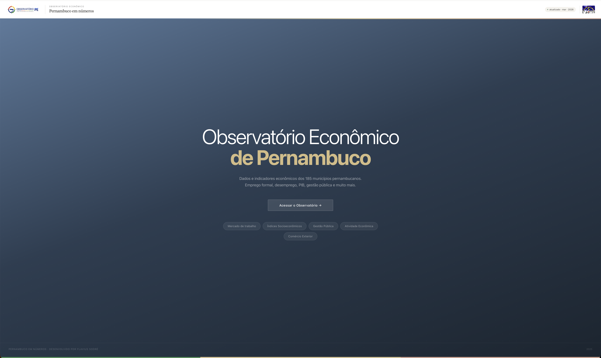

# Observatório Econômico de Pernambuco

<!-- Depois de gerar o DOI no Zenodo, troque XXXXXXX pelo número e apague as marcas de comentário desta linha -->
<!-- [](https://doi.org/10.5281/zenodo.XXXXXXX) -->

Painel interativo de acesso aberto com indicadores econômicos e sociais de Pernambuco e de seus 185 municípios, desenvolvido em Python/Dash por Flavius Sodré.

**Acesse:** https://www.observatorioeconomicope.com.br



## Por que existe

Os indicadores econômicos de Pernambuco estão espalhados por bases de vários órgãos, com formatos e periodicidades diferentes. O observatório coleta, padroniza e integra essas bases num único painel, com recorte por município e por Região de Desenvolvimento, para quem precisa acompanhar a economia do estado: gestores, empresas, entidades, estudantes e pesquisadores.

## Onde é usado

- Como recurso didático em disciplinas da Universidade Católica de Pernambuco (Unicap), como o Projeto Integrador V do curso de Administração.
- No projeto de extensão "Dados Abertos a Serviço da Gestão – Workshop de Dashboards Gerenciais" (Unicap).

## Novidades da versão 2.0

- **Gestão Pública:** nova sub-aba **FPM**, com valores brutos, crescimento real, per capita, decêndios e as parcelas extras de 1%. A antiga sub-aba Receita Fiscal virou **Transferências** e teve a leitura dos dados corrigida: as linhas que o Tesouro rotula como ICMS, IPVA e FPE dentro do FUNDEB são FUNDEB recebido, e não cota-parte desses impostos. A série agora começa em 2019, e o mês de dezembro de 2025, que faltava, foi recuperado.
- **Atividade Econômica:** quatro sub-abas.
  - Visão geral: IBC-R, PIB trimestral, termômetro setorial e inflação na RM do Recife.
  - Indústria.
  - Comércio e serviços.
  - Agropecuária: lavouras, safra e pecuária, com mapas municipais.
- **Comércio Exterior:** quatro sub-abas, todas em US$ FOB desde 2019.
  - Balança comercial.
  - Produtos e mercados.
  - Municípios.
  - Agronegócio, pela classificação do Agrostat.
- **Indicadores Sociais**, um eixo novo:
  - Progresso social: Índice de Progresso Social de cada município.
  - Segurança pública: mortes violentas intencionais desde 2004, com taxas por 100 mil habitantes.
- **ETL automático:** a maior parte das bases agora é baixada direto das APIs oficiais quando o ETL roda. São elas IBGE, Banco Central, Comex Stat, Tesouro e SDS-PE. O ETL também atualiza sozinho a tabela de períodos deste README.
- **Anos nos títulos:** os anos que apareciam fixos nos títulos das abas passaram a sair dos próprios dados.

## O que o painel mostra

| Eixo · sub-aba | Conteúdo | Fonte | Atualização da fonte |
| --- | --- | --- | --- |
| Mercado de trabalho · Emprego formal | Admissões, desligamentos e saldo por município, sexo e setor; mapa dos 185 municípios | Novo Caged · MTE | Mensal |
| Mercado de trabalho · Desemprego | Desocupação, ocupação, rendimento médio, desalento, informalidade, pobreza e extrema pobreza; comparação com o Nordeste | PNAD Contínua · IBGE | Trimestral |
| Índices Socioeconômicos · PIB municipal | PIB nominal e real (IPCA), PIB per capita, VAB setorial e dependência de impostos | SEPLAG-PE · IBGE (Contas Regionais) | Anual |
| Gestão Pública · Eleições municipais | Prefeitos e vereadores eleitos | TSE | A cada eleição |
| Gestão Pública · FPM | FPM bruto, crescimento nominal e real, per capita, FPM/PIB, decêndios, parcelas extras de 1%; mapa e rankings | STN · Tesouro Transparente | Mensal (por decêndio) |
| Gestão Pública · Transferências | Tudo o que a União credita aos municípios: FPM, FUNDEB, royalties, ITR, Lei Kandir, apoio financeiro; composição e evolução | STN · Tesouro Transparente | Mensal |
| Atividade Econômica · Visão geral | IBC-R de PE, Nordeste e Brasil; PIB trimestral; termômetro setorial; IPCA da RM do Recife por grupo | BCB; CONDEPE/FIDEM e SEPLAG-PE; IBGE | Mensal e trimestral |
| Atividade Econômica · Indústria | Produção física industrial de PE e do Brasil, por atividade | PIM-PF · IBGE | Mensal |
| Atividade Econômica · Comércio e serviços | Varejo, varejo ampliado, serviços e turismo; atividades do varejo e dos serviços | PMC e PMS · IBGE | Mensal |
| Atividade Econômica · Agropecuária | Valor das lavouras, mapas municipais por produto, estimativa da safra do ano, rebanhos e produção de origem animal | PAM, LSPA e PPM · IBGE | Anual e mensal |
| Comércio Exterior · Balança comercial | Exportações, importações, saldo e corrente de comércio; PE no Nordeste | Comex Stat · MDIC | Mensal |
| Comércio Exterior · Produtos e mercados | Principais produtos (SH4) e países; cruzamento produto x país | Comex Stat · MDIC | Mensal |
| Comércio Exterior · Municípios | Comércio exterior por município (domicílio da empresa), produtos de cada município | Comex Stat · MDIC | Mensal |
| Comércio Exterior · Agronegócio | Exportações do agronegócio por setor, produto e destino; sazonalidade | Comex Stat · MDIC; Agrostat · MAPA | Mensal |
| Indicadores Sociais · Progresso social | IPS, dimensões e componentes por município; ranking, RDs, PIB per capita x IPS, ficha do município | IPS Brasil | Anual |
| Indicadores Sociais · Segurança pública | Mortes violentas intencionais desde 2004, taxa por 100 mil habitantes, mapa, RDs e perfil das vítimas | SDS-PE (microdados) | Mensal |

Cobertura: 185 municípios (184 e o distrito estadual de Fernando de Noronha) e as 12 Regiões de Desenvolvimento de Pernambuco.

## Períodos disponíveis

<!-- PERIODOS:INICIO -->
<!-- Tabela gerada por etl/run_all.py a partir do catálogo. Não edite à mão. -->

| Base | Onde aparece | Fonte | Período | Gerada em |
|---|---|---|---|---|
| Emprego formal por município | Mercado de trabalho · Emprego formal | Novo CAGED · MTE | jan/2020 a set/2026 | 16/11/2026 |
| Emprego formal por sexo | Mercado de trabalho · Emprego formal | Novo CAGED · MTE | jan/2020 a set/2026 | 16/11/2026 |
| Emprego formal por grande setor | Mercado de trabalho · Emprego formal | Novo CAGED · MTE | jan/2020 a set/2026 | 16/11/2026 |
| Mercado de trabalho de Pernambuco | Mercado de trabalho · Desemprego | PNAD Contínua · IBGE | 2012T1 a 2026T2 | 16/11/2026 |
| Mercado de trabalho nos estados do NE | Mercado de trabalho · Desemprego | PNAD Contínua · IBGE | 2012T1 a 2026T2 | 16/11/2026 |
| Pobreza e extrema pobreza | Mercado de trabalho · Desemprego | PNAD Contínua · IBGE | 2012T1 a 2026T2 | 16/11/2026 |
| PIB dos municípios | Índices Socioeconômicos · PIB municipal | SEPLAG-PE / IBGE · Contas Regionais | 2010 a 2023 | 16/11/2026 |
| Prefeitos eleitos | Gestão Pública · Eleições municipais | TSE | — | 16/11/2026 |
| Vereadores eleitos | Gestão Pública · Eleições municipais | TSE | — | 16/11/2026 |
| População dos municípios | per capita e taxas | IBGE · estimativas e Censo 2022 | 2001 a 2026 | 16/11/2026 |
| Transferências constitucionais (FPM, FUNDEB, royalties...) | Gestão Pública · FPM e Transferências | STN · Tesouro Transparente | jan/2019 a set/2026 | 16/11/2026 |
| IBC-R, indústria, comércio, serviços e IPCA | Atividade Econômica | BCB · IBGE (PIM-PF, PMC, PMS, IPCA) | jan/2003 a out/2026 | 16/11/2026 |
| PIB trimestral | Atividade Econômica · Visão geral | CONDEPE/FIDEM · SEPLAG-PE (planilha) | 2022T1 a 2025T3 | 16/11/2026 |
| Produção agrícola municipal | Atividade Econômica · Agropecuária | IBGE · PAM | 2015 a 2025 | 16/11/2026 |
| Estimativas de safra | Atividade Econômica · Agropecuária | IBGE · LSPA | nov/2023 a out/2026 | 16/11/2026 |
| Pecuária municipal | Atividade Econômica · Agropecuária | IBGE · PPM | 2015 a 2025 | 16/11/2026 |
| Exportações e importações (UF do produto) | Comércio Exterior | Comex Stat · MDIC | jan/2019 a out/2026 | 16/11/2026 |
| Exportações e importações por município | Comércio Exterior · Municípios | Comex Stat · MDIC | jan/2019 a out/2026 | 16/11/2026 |
| Índice de Progresso Social | Indicadores Sociais · Progresso social | IPS Brasil | edições 2024 a 2026 | 16/11/2026 |
| Mortes violentas intencionais | Indicadores Sociais · Segurança pública | SDS-PE · microdados | jan/2004 a out/2026 | 16/11/2026 |

<!-- PERIODOS:FIM -->

## Como rodar localmente

```bash
git clone https://github.com/FlaviusSodre/Dashboard-Observatorio_Economico.git
cd Dashboard-Observatorio_Economico
python -m venv .venv
source .venv/bin/activate        # no Windows: .venv\Scripts\activate
pip install -r requirements.txt
python -m etl.run_all            # baixa e processa os dados (a primeira vez leva alguns minutos)
python app.py                    # abre em http://127.0.0.1:8050
```

O `requirements.txt` traz os pacotes do site e os do ETL (leitura de `.xls` e de PDF, downloads com validação de certificado pelo sistema operacional). O site não usa os do ETL: no servidor, eles só ocupam espaço em disco.

**Pasta no iCloud (Mac):** se o projeto fica em Documentos ou na Mesa com o iCloud ativo, o macOS pode tirar do disco os arquivos do `.venv`. Quando isso acontece, `python app.py` fica parado sem mensagem. Há duas saídas:
- criar o ambiente fora do iCloud, por exemplo `python -m venv ~/.venvs/observatorio` e depois `source ~/.venvs/observatorio/bin/activate`;
- ou, no Finder, clicar com o botão direito na pasta do projeto e escolher **Manter Baixado**.

## Atualização dos dados

```bash
python -m etl.run_all                    # tudo
python -m etl.run_all --so comex         # só uma etapa (geo, caged, pnad, setor, pnad_regional, rd,
                                         # prefeitos, pib, populacao, transferencias, atividade,
                                         # comex, ips, seguranca)
python -m etl.run_all --offline          # sem internet, com a última cópia baixada
```

Cada etapa roda isolada: se uma fonte estiver fora do ar, as outras seguem e o resumo final mostra o que falhou. Os downloads ficam em `data/cache/`, fora do git; nas execuções seguintes só o que mudou é baixado de novo.

**O que é automático:**
- População, do IBGE.
- Transferências, do Tesouro.
- IBC-R, do BCB.
- PIM, PMC, PMS, IPCA, LSPA, PAM e PPM, do IBGE.
- Comex Stat.
- Microdados de MVI, da SDS-PE. O link muda todo mês, e o ETL acha o link novo na página da SDS.
- Malha municipal.
- VAB e impostos municipais a partir de 2022, da tabela SIDRA 5938. Hoje o IBGE só divulgou o PIB de 2022 e 2023, sem essa abertura. Quando publicar, o ETL completa a base sozinho.

**O que continua manual:**

| Base | Onde salvar | Como obter |
| --- | --- | --- |
| Novo Caged | `data/raw/CAGED_PE.xlsx`, `data/raw/CAGED_SETOR_PE.xlsx` | Painel do Novo Caged e tabelas do MTE (como nas versões anteriores) |
| PNAD Contínua | `data/raw/pnad_regional/*.xlsx` | Microdados e SIDRA do IBGE (como nas versões anteriores) |
| PIB municipal | `data/raw/PIB_PE_*.xls` e `.pdf` | SEPLAG-PE |
| PIB trimestral | `data/raw/pib_trimestral_pe.csv` | A cada divulgação da Agência CONDEPE/FIDEM, acrescente uma linha para Pernambuco e outra para o Brasil (instruções no cabeçalho do arquivo). Painel: [SEPLAG-PE, PIB trimestral](https://app.powerbi.com/view?r=eyJrIjoiYWNkMmY1YWQtMzliNS00MzdiLWEzNzgtOTZiMTc5NDNjMGNhIiwidCI6IjA5NWY4NjAxLTRhOWEtNDQ5MC1hODBkLWJmMTA4NTliODkxMCJ9) |
| IPS Brasil | `data/raw/ips/` (um XLSX por edição) | [ipsbrasil.org.br/explore/data](https://ipsbrasil.org.br/explore/data) → escolha o ano → Filtrar → Download → **XLSX** (dataset completo). Uma vez por ano |
| Agronegócio (lista de NCMs) | `data/raw/agrostat_ncm_agronegocio.xlsx` | [Agrostat](https://mapa-indicadores.agricultura.gov.br/publico/extensions/Agrostat/Agrostat.html) → Tabela de Agrupamentos → marque Setores, Subsetores, Produtos e NCM → marque Agronegócio → ícone do Excel. Só quando o MAPA mudar a classificação |

## Estrutura do projeto

```
app.py                  entrada principal
config.py               paleta, caminhos e metadados
requirements.txt        pacotes do site e do ETL
data/
  raw/                  arquivos mantidos à mão (Caged, PNAD, PIB, IPS, Agrostat, PIB trimestral)
  cache/                downloads automáticos do ETL (fora do git)
  processed/            parquets gerados pelo ETL + catalogo.json
  geo/                  malha municipal (GeoJSON do IBGE)
etl/
  run_all.py            orquestrador (etapas isoladas, --offline, --so)
  _fontes.py            downloads com cache e novas tentativas; APIs do SIDRA e do SGS
  *_etl.py              uma base por arquivo
components/
  data.py               acesso aos dados das abas da v1
  data_base.py          população, deflator do IPCA e regiões (v2)
  data_fiscal.py        FPM e transferências
  data_atividade.py     atividade econômica e agropecuária
  data_comex.py         comércio exterior e agronegócio
  data_social.py        IPS e segurança pública
  charts.py, ui.py      gráficos e componentes de interface
  viz.py                formatação brasileira, KPIs e gráficos das abas da v2
tabs/                   uma sub-aba por arquivo; _template.py é o modelo para novas abas
assets/                 CSS, ícones e manifesto do aplicativo instalável (PWA)
```

O observatório é extensível: cada nova temática entra como um arquivo em `tabs/`, sem refatorar o restante.

## Fontes de dados

Todos os dados vêm de bases públicas oficiais. Os direitos e as condições de uso de cada base são os do órgão de origem; cite a fonte original ao reutilizar os dados. O painel usa apenas dados agregados e não trata dados pessoais sensíveis. Os nomes de prefeitos e vereadores eleitos são informação pública do TSE, e os microdados de mortes violentas da SDS-PE não identificam as vítimas.

- Ministério do Trabalho e Emprego: Novo Caged
- IBGE:
  - PNAD Contínua
  - Contas Regionais e PIB dos Municípios
  - PIM-PF, PMC e PMS
  - IPCA
  - LSPA, PAM e PPM
  - estimativas de população e Censo 2022
  - malha municipal
- Banco Central do Brasil: IBC-R e IBC-Br (SGS)
- Secretaria de Planejamento e Gestão de Pernambuco (SEPLAG-PE) e Agência CONDEPE/FIDEM: PIB municipal e PIB trimestral
- Tribunal Superior Eleitoral: resultados das eleições municipais
- Secretaria do Tesouro Nacional: transferências constitucionais (Tesouro Transparente)
- Ministério do Desenvolvimento, Indústria, Comércio e Serviços: Comex Stat
- Ministério da Agricultura e Pecuária: Agrostat
- IPS Brasil: Índice de Progresso Social
- Secretaria de Defesa Social de Pernambuco: microdados de mortes violentas intencionais
- Pernambuco em números: Regiões de Desenvolvimento

## Nota metodológica

**Valores e comparações**
- **Valores reais:**
  - O PIB e o PIB per capita estão a preços de 2023, deflacionados pelo IPCA.
  - Nas abas da v2.0, os valores reais estão a preços do último mês com IPCA divulgado. O deflator é o IPCA mensal do Brasil (SIDRA 1737).
- **Ano incompleto:** quando o ano ainda não terminou, por exemplo 2026 de janeiro a outubro, a comparação é feita com os mesmos meses do ano anterior.

**Emprego e atividade**
- **Saldo de emprego:** admissões menos desligamentos no mês, segundo o Novo Caged.
- **IBC-R:** índice dessazonalizado do Banco Central, rebaseado para a média de 2019 = 100. As variações em 12 meses usam a série sem ajuste.
- **PIM, PMC e PMS:** variações em volume, já descontada a inflação.

**Gestão Pública**
- **FPM bruto:** FPM creditado + retenção de 20% para o FUNDEB + parcelas extras de 1% (julho, setembro e dezembro).
  - A retenção vem da linha DEDU do Tesouro, que corresponde a 25% de (FPM + ITR) creditados. O painel separa a parte do ITR.
  - Até 2024 a parcela de 1% vinha somada ao FPM. O painel a isola porque ela não sofre retenção do FUNDEB.
- **Transferências (total creditado):** soma de tudo o que entra na conta do município (FPM, FUNDEB recebido, royalties, ITR, Lei Kandir, apoio financeiro, CIDE e IOF-Ouro).
  - Não inclui as retenções para o FUNDEB, que voltam ao município como FUNDEB recebido.
  - A cota-parte estadual do ICMS e do IPVA não está nesta base.
- **Meses incompletos no Tesouro:** alguns arquivos mensais do Tesouro vieram sem decêndios, um veio em centavos (set/2024) e o de out/2022 não foi publicado. O ETL confere FPM, FUNDEB, ITR, CIDE e LC 176 com a série consolidada "Transferências Obrigatórias da União por Município" e, onde há diferença, usa o total consolidado do mês, sem o detalhe por decêndio. Royalties não têm série consolidada; os de out/2022 não estão na base.

**Comércio Exterior**
- **Valores e ótica:** valores em US$ FOB. Os totais do estado usam a ótica "UF do produto" do Comex Stat. A aba Municípios usa o domicílio fiscal da empresa, por isso os totais diferem.
- **Agronegócio:** NCMs classificadas como agronegócio pelo Agrostat (MAPA).

**Indicadores Sociais**
- **Mortes violentas intencionais (MVI):** homicídios, feminicídios, latrocínios, lesões corporais seguidas de morte e mortes por intervenção de agente do Estado.
  - A taxa é calculada por 100 mil habitantes, com a população do IBGE (estimativas e Censo 2022; anos sem estimativa são interpolados).
  - Em ano incompleto, a taxa é anualizada.
- **IPS:** escala de 0 a 100.
  - As médias de Pernambuco, do Nordeste e do Brasil são médias simples dos municípios.
  - As edições 2024, 2025 e 2026 não são estritamente comparáveis, conforme a própria fonte.

**Cores dos gráficos**
- Cada entidade tem sempre a mesma cor: Pernambuco em azul, Nordeste em terracota, Brasil em cinza; exportação em azul, importação em terracota.
- Os mapas de magnitude usam um só tom, do claro ao escuro. Os de variação usam terracota (queda), cinza e azul (alta).

## Privacidade

O site conta acessos de forma anônima, sem cookies e sem coletar dados pessoais.

## Como citar

Use o botão "Cite this repository", na coluna da direita do GitHub, ou:

> SODRÉ, Flavius Raymundo Arruda. **Observatório Econômico de Pernambuco**. Versão 2.0. Recife, 2026. Software. Disponível em: https://doi.org/10.5281/zenodo.XXXXXXX.

## Autoria

Projeto pessoal de Flavius Raymundo Arruda Sodré, professor da Universidade Católica de Pernambuco (Unicap), responsável pela concepção, pelo desenvolvimento e pela manutenção do painel.

## Licença

Copyright (C) 2026 Flavius Raymundo Arruda Sodré.

Este programa é software livre, distribuído sob a GNU Affero General Public License, versão 3 ou posterior (arquivo `LICENSE`). Você pode usá-lo, estudá-lo e modificá-lo. Se distribuir uma versão modificada ou colocá-la no ar como serviço na internet, deve disponibilizar o código-fonte completo sob a mesma licença e manter este aviso de autoria. O programa é oferecido sem nenhuma garantia.

Os dados exibidos seguem as condições de uso de cada órgão de origem.
